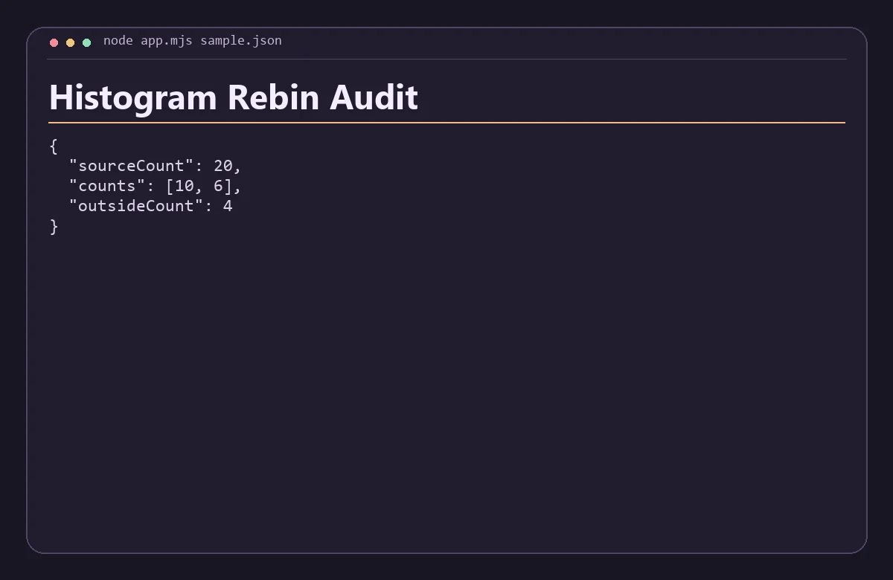

# Histogram Rebin Audit

Redistribute histogram mass across different bin boundaries and report mass outside the target range.



## Run

Install Node.js 22 or newer. Run these commands from the repository root.

```sh
node app.mjs sample.json
```

Replace `sample.json` with a JSON file following the same structure. The app prints a JSON report to standard output.

Supply strictly increasing source and target edges. Each input bin’s mass is distributed uniformly across its width, so the result estimates the rebinned counts when original samples are unavailable. Output counts can be fractional.

## Verify

Run `python check.py` with Python 3.11 or newer after the build step when applicable. The check verifies the bundled scenario and confirms that an invalid input returns an error.
